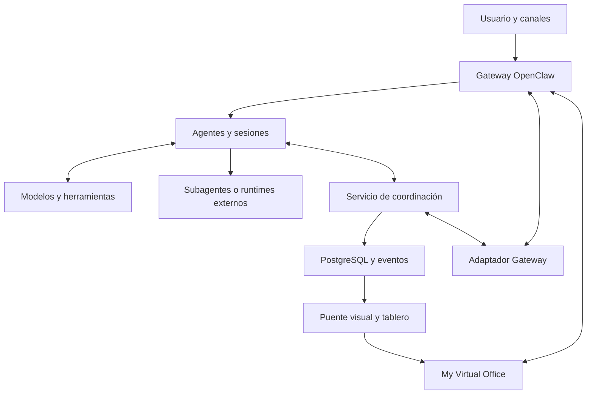
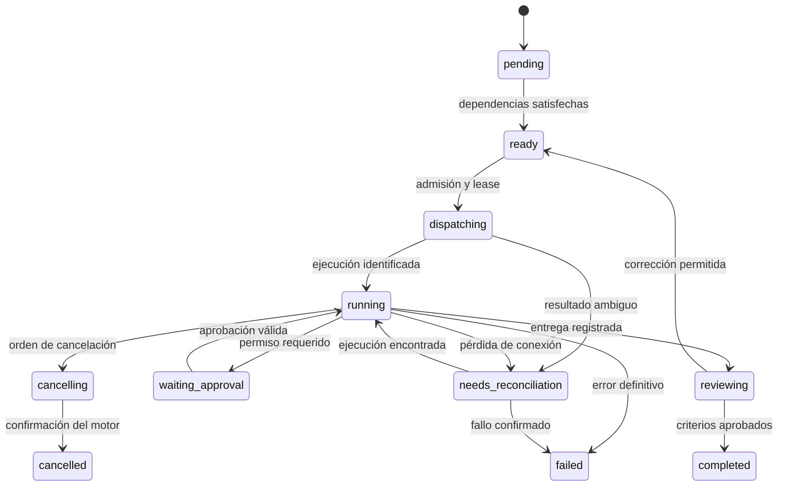

# SDD — Plataforma de orquestación OpenClaw + My Virtual Office

**Versión:** 2.0 completa  
**Fecha:** 16/11/2026  
**Destino:** implementación incremental con Codex  
**Estado:** diseño propuesto; no implica despliegue ni pruebas ya realizadas  
**Sustituye:** SDD 1.0 limitado al MVP

## 1. Propósito y alcance del documento

Construir un equipo personal de IA disponible 24/7, con agentes especializados, delegación, trabajo simultáneo, memoria, herramientas, automatizaciones y supervisión mediante una oficina visual interactiva.

Se integran **OpenClaw real como motor** y **My Virtual Office como interfaz**. Codex desarrolla configuración, extensiones, servicio de coordinación y pruebas. No se reimplementa el motor ni se da por existente una compatibilidad que no haya sido comprobada.

Este SDD cubre el sistema completo objetivo y su ruta de implementación, no solo el MVP. “Completo” significa que especifica responsabilidades, contratos, flujos, fallos y aceptación para las capacidades del proyecto. No significa reproducir cada plugin presente o futuro de OpenClaw. Las funciones nativas disponibles se inventariarán al fijar versiones; las funciones adicionales se habilitan por capacidad.

### Objetivos

- Recibir un objetivo general y convertirlo en tareas verificables.
- Seleccionar agentes, herramientas y modelos apropiados.
- Ejecutar simultáneamente trabajo independiente y respetar dependencias.
- Conservar contexto, memoria, resultados y trazabilidad.
- Permitir interacción humana durante el trabajo.
- Recuperar el servicio y reconciliar ejecuciones después de fallos.
- Mostrar actividad real y comunicaciones entre agentes en la oficina.
- Operar dentro de límites de recursos, permisos y presupuesto.

### Límites

Ningún agente puede garantizar resolver cualquier pedido. Depende de sus herramientas, fuentes, modelos y permisos. Disponibilidad 24/7 no equivale a inferencia continua. La primera instalación será de un único propietario; multiempresa, facturación y marketplace quedan fuera. Los roles de acceso futuros se contemplan, sin convertir el MVP en un SaaS multiusuario.

## 2. Contexto de despliegue y decisiones

Entorno objetivo: VPS Ubuntu Server, Docker Compose, GitHub Actions y Nginx Proxy Manager. Acceso inicial privado mediante Tailscale o red interna. Horarios del usuario: America/Argentina/Catamarca; almacenar fechas en UTC y mostrar zona explícita.

| Decisión | Motivo |
| --- | --- |
| Reutilizar OpenClaw | Aprovechar sesiones, herramientas, delegación y automatización nativas. |
| Reutilizar My Virtual Office | Obtener personajes, oficina y chat sin rehacer el producto. |
| Servicio propio TypeScript + Fastify | Aplicar reglas de negocio, planificación durable y reconciliación. |
| PostgreSQL + Prisma | Registrar tareas, intentos, dependencias, auditoría y entregables. |
| Transporte nativo hacia Gateway | Evitar controlar agentes mediante scraping o terminales simuladas. |
| API HTTP y SSE para extensiones propias | Comandos explícitos y eventos reanudables. |
| Sin Redis/BullMQ inicialmente | El despacho propio puede usar PostgreSQL; evitar otra cola de ejecución. |
| Sin LangGraph inicialmente | OpenClaw es el runtime elegido; no duplicar su bucle de agente. |

No añadir Next.js como segunda interfaz por defecto. Si la oficina no ofrece un punto de extensión suficiente, crear un módulo web pequeño enlazado desde ella para el tablero de objetivos; registrar la necesidad y mantener estilo consistente.

## 3. Fuentes, versiones y evidencia

Fuentes oficiales o repositorios primarios consultados el 16/11/2026:

| ID | Fuente |
| --- | --- |
| S01 | https://docs.openclaw.ai/concepts/architecture |
| S02 | https://docs.openclaw.ai/multi-agent |
| S03 | https://docs.openclaw.ai/concepts/session-tool |
| S04 | https://docs.openclaw.ai/automation |
| S05 | https://docs.openclaw.ai/tools/acp-agents |
| S06 | https://github.com/openclaw/openclaw/blob/main/docs/concepts/compaction.md |
| S07 | https://github.com/openclaw/docs/blob/main/docs/concepts/memory.md |
| S08 | https://github.com/eliautobot/my-virtual-office/blob/main/README.md |
| S09 | https://github.com/eliautobot/my-virtual-office/blob/main/docs/PROVIDER-SDK.md |
| S10 | https://github.com/eliautobot/my-virtual-office/blob/main/docs/VIRTUAL_OFFICE_AGENT_TOOLS.md |
| S11 | https://github.com/eliautobot/my-virtual-office/blob/main/LICENSE |
| S12 | https://docs.openclaw.ai/ |

Hechos que orientan la integración:

- OpenClaw posee un Gateway central y permite agentes con ámbitos separados, sesiones y espacios de trabajo [S01–S02].
- Las herramientas de sesiones permiten consultar, comunicar y delegar ejecuciones [S03].
- Las automatizaciones actuales no deben confundirse con las APIs antiguas Tasks/TaskFlow retiradas [S04].
- ACP permite conectar runtimes externos; no es sinónimo de subagente nativo [S05].
- La compactación reduce contexto enviado al modelo; no equivale a borrar todo el historial ni a memoria de negocio [S06–S07].
- My Virtual Office tiene integración OpenClaw y un contrato de proveedores por capacidades [S08–S09].

Todo lo definido como contrato, política, entidad o endpoint en este SDD es **diseño propio**, salvo identificación expresa como capacidad upstream.

Antes de programar, crear `docs/COMPATIBILITY.md` con: componente, versión, commit/digest, protocolo, autenticación, funciones verificadas, limitaciones, prueba y fecha. No fijar supuestas versiones “compatibles” sin ejecutar la prueba. Nunca desplegar imágenes `latest` en producción.

La oficina tiene licencia AGPL-3.0 en el repositorio consultado y un flujo de clave de activación/demo documentado [S08, S11]. Comprobar funciones habilitadas y condiciones aplicables antes de decidir reutilización, fork o distribución. No prometer gratuidad total ni eludir activación. Modelos, servicios externos y VPS se contabilizan aparte.

## 4. Matriz de cobertura funcional

N = nativo, condicionado a versión/configuración; P = desarrollo propio; V = integración visual a verificar.

| ID | Capacidad | Responsable | Alcance objetivo |
| --- | --- | --- | --- |
| CAP-01 | Agentes, perfiles y enrutamiento | OpenClaw N | Descubrimiento, configuración y asignación. |
| CAP-02 | Sesiones e historial | OpenClaw N | Crear, consultar, continuar y cancelar donde corresponda. |
| CAP-03 | Delegación y subagentes | OpenClaw N + P | Árbol de trabajo trazable y límites globales. |
| CAP-04 | Paralelismo y dependencias | N + P | DAG validado, admisión y ejecución concurrente. |
| CAP-05 | Planificación y revisión | P sobre agentes | Plan versionado, criterios y evidencia. |
| CAP-06 | Comunicación entre agentes | N + P + V | Mensajes correlacionados, handoffs y visibilidad. |
| CAP-07 | Contexto y compactación | OpenClaw N | Continuidad sin duplicar efectos. |
| CAP-08 | Memoria personal y de proyecto | N + P | Ámbitos, procedencia, retención y corrección. |
| CAP-09 | Herramientas, skills y plugins | OpenClaw N | Catálogo permitido, versiones y auditoría. |
| CAP-10 | Modelos y fallback | N + P | Selección por capacidad, presupuesto y error. |
| CAP-11 | Cron, eventos y webhooks | OpenClaw N + P | Disparadores persistentes y deduplicados. |
| CAP-12 | Canales externos | OpenClaw N + P | Activación progresiva y enrutamiento explícito. |
| CAP-13 | Navegador, archivos y multimedia | N + P + V | Permisos y presentación de resultados compatibles. |
| CAP-14 | Dispositivos y ejecución remota | OpenClaw N + V | Fase avanzada, emparejamiento y autoridad. |
| CAP-15 | OpenCode/otros runtimes ACP | OpenClaw N + P | Fase avanzada, contrato de ejecución común. |
| CAP-16 | Aprobaciones y sandbox | N + P + V | Políticas aplicadas en servidor. |
| CAP-17 | Oficina y personajes | My Virtual Office N + V | Actividad, sesiones y conversaciones comprobables. |
| CAP-18 | Auditoría, presupuesto y recuperación | P + señales N | Registro durable y reconciliación. |
| CAP-19 | Copias, despliegue y actualización | P | Restauración y rollback probados. |

Esta matriz es el inventario de implementación. Una capacidad solo pasa a “soportada” con evidencia; la existencia de un botón o una animación no es suficiente.

## 5. Arquitectura lógica



### Componentes

1. **Gateway:** propietario de sesiones, runtime nativo, autenticación de dispositivos y operaciones soportadas.
2. **Oficina:** propietario del diseño visual, personajes y preferencias de interfaz.
3. **Servicio de coordinación:** propietario de objetivos, planes, dependencias, admisión, intentos y evaluación.
4. **Adaptador Gateway:** traduce el contrato propio a operaciones reales de la versión fijada.
5. **Puente visual:** convierte eventos de negocio en actividad visual soportada; no ejecuta tareas.
6. **Persistencia:** PostgreSQL para negocio; almacenamiento propio de OpenClaw y oficina para sus dominios.
7. **Workspaces y entregables:** archivos de trabajo aislados y artefactos publicados con checksum.
8. **Proxy y operación:** acceso, salud, despliegue, copias y alertas.

### Fuente de verdad

| Dato | Autoridad |
| --- | --- |
| Resultado técnico de una ejecución | Runtime propietario, reconciliado por el adaptador. |
| Objetivo, DAG, estado de aceptación | Servicio de coordinación. |
| Transcript y sesión nativa | OpenClaw o runtime externo. |
| Personaje, posición y decoración | My Virtual Office. |
| Aprobación de herramienta nativa | Proveedor nativo; registro propio como espejo auditado. |
| Política de admisión y presupuesto global | Servicio de coordinación. |
| Archivos publicados | Almacén de artefactos con manifiesto. |

No escribir directamente en bases internas de OpenClaw/oficina. Utilizar interfaces soportadas, excepto backup/restauración realizados siguiendo procedimientos oficiales.

## 6. Control de ejecución: una sola autoridad de despacho

En trabajos administrados, el coordinador IA propone un plan pero no lanza arbitrariamente subagentes fuera del servicio. Expone herramientas propias como `submit_plan`, `request_dispatch` y `report_artifact`. El servicio valida y despacha por el adaptador.

En chats libres, OpenClaw puede ejecutar sus capacidades nativas; se muestran como actividad no administrada. Antes de prometer límites globales se debe impedir que esas rutas evadan la admisión o reservarles capacidad separada.

El adaptador usará llamadas admitidas o una extensión upstream pequeña. La fase de compatibilidad debe demostrar creación, consulta, correlación y cancelación. No asumir que todas las herramientas del modelo tienen un RPC HTTP equivalente.

Contrato conceptual del adaptador:

```typescript
interface RuntimeAdapter {
  capabilities(): Promise<CapabilitySet>;
  start(input: StartRunRequest): Promise<RunReference>;
  inspect(ref: RunReference): Promise<RunSnapshot>;
  cancel(ref: RunReference): Promise<CancelReceipt>;
  respondApproval(input: ApprovalDecision): Promise<ApprovalReceipt>;
  observe(cursor?: string): AsyncIterable<RuntimeEvent>;
}
```

Son tipos a implementar, no nombres de métodos upstream. Capacidades de pausa, steering, replay o aprobación se declaran explícitamente; no se emulan silenciosamente.

## 7. Modelo de agentes y roles

Cada perfil declara identidad, misión, criterios, herramientas, modelo, memoria permitida, presupuesto y política de delegación. Perfil, sesión, ejecución y personaje son entidades diferentes.

| Rol | Trabajo | Límite inicial |
| --- | --- | --- |
| Coordinador | Clarificar, planificar, supervisar y consolidar. | Delegar mediante servicio; no aprobar su propia entrega. |
| Investigador | Buscar, contrastar y registrar fuentes. | Acceso de lectura y escritura en su workspace. |
| Ejecutor | Crear documentos, código o transformaciones. | Sin credenciales de producción. |
| Revisor | Verificar criterios, archivos y pruebas. | Devolver evidencia y defectos concretos. |
| Operador | Revisar salud, backups e incidencias. | Lectura primero; acciones correctivas autorizadas. |

El operador se habilita en la fase operativa; inicialmente funcionan los cuatro primeros. Frontend, backend, redactor y analista son especializaciones del ejecutor/investigador, no servicios nuevos obligatorios.

No compartir `agentDir` entre perfiles. Workspaces separados ayudan a organizar, pero no son una frontera de seguridad sin sandbox [S02]. Configurar almacenamiento de plugins que deba quedar aislado.

## 8. Ingreso, routing y autorización

Todo pedido crea un `Request` con fuente, actor autenticado, identificador externo, proyecto, mensaje y adjuntos. La identidad del canal se resuelve en servidor; un texto que diga “soy administrador” no concede permisos.

El routing selecciona proyecto, agente y sesión mediante reglas deterministas, con fallback a coordinador. Las inferencias del modelo no pueden cambiar la identidad del solicitante.

Canales objetivo: oficina primero; luego un canal elegido —por ejemplo Telegram— y después los adicionales. Habilitar cada uno con permisos de lectura/envío, destinatarios admitidos, deduplicación y prueba de entrega. No implementar todos por anticipado.

Si se solicita una acción sin acceso o información imprescindible, generar `waiting_input` con una pregunta concreta. Conservar la tarea y permitir continuar; no bloquear otros proyectos.

Los mensajes que no crean trabajo —consulta de estado o cancelación— no deben generar un plan nuevo.

## 9. Planificación y grafos de tareas

El coordinador genera un plan JSON validado por esquema:

```json
{
  "objective": "Comparar dos soluciones y entregar un informe",
  "revision": 1,
  "tasks": [
    {"key":"a","role":"researcher","dependsOn":[],"deliverable":"a.md","criteria":["Fuentes identificadas"]},
    {"key":"b","role":"researcher","dependsOn":[],"deliverable":"b.md","criteria":["Fuentes identificadas"]},
    {"key":"review","role":"reviewer","dependsOn":["a","b"],"deliverable":"informe.md","criteria":["Comparación y limitaciones"]}
  ]
}
```

Reglas obligatorias:

- Claves únicas, referencias existentes y grafo sin ciclos.
- Criterios comprobables y entregable o resultado explícito por tarea.
- Límites configurados de cantidad de tareas y profundidad.
- No iniciar descendientes hasta aceptar los resultados requeridos.
- Planes revisados mantienen historial y relacionan tareas sustituidas.
- Cambios que invalidan trabajo aceptado requieren reevaluación, no borrado.
- Las tareas simples se ejecutan directamente sin forzar un equipo.
- Un fallo de dependencia bloquea descendientes; solo continúa una rama opcional si el plan define tolerancia al fallo.

Patrones soportados: secuencia, fan-out/fan-in, supervisor con especialistas, revisión con correcciones limitadas y handoff. Evitar redes ilimitadas de agentes conversando sin objetivo.

## 10. Admisión, concurrencia y presupuesto

Valores iniciales de diseño —configurables y medidos en staging—:

| Parámetro | Valor inicial |
| --- | --- |
| Ejecuciones activas administradas | 3 totales |
| Especialistas simultáneos | 2 dentro del límite total |
| Ejecuciones por workspace mutable | 1 |
| Profundidad de delegación | 2 |
| Tareas por plan | 20 |
| Correcciones por tarea | 2 |
| Reintentos de error transitorio | 2 |
| Tiempo de tarea interactiva | 15 minutos |
| Tiempo de tarea larga | 60 minutos, explícito |
| Presupuesto monetario | Configuración obligatoria antes de trabajo desatendido |

La admisión usa transacciones, lease y token de fencing. Una tarea reclamada pasa a `dispatching`; se registra la intención antes de contactar al motor. El token impide que un worker antiguo escriba resultados como vigente, pero no detiene efectos externos ya iniciados: estos requieren reconciliación.

Prioridad: intervención humana y cancelación, trabajo interactivo, tareas programadas, mantenimiento. Implementar antigüedad para evitar starvation. Contabilizar concurrencia de runtimes externos y procesos hijos.

Al alcanzar un límite, encolar o bloquear con motivo visible. Reservar presupuesto antes del despacho y reconciliarlo con uso real. Si el proveedor no informa costos, usar estimación etiquetada y un tope de llamadas/tokens como respaldo; no mostrar costo cero.

## 11. Ciclo de vida y transiciones



Estados adicionales: `blocked`, `waiting_input` y `paused`. Pausa significa detener nuevos despachos; una ejecución activa solo se suspende si el runtime lo soporta. En otro caso se ofrece cancelación con explicación.

`completed` es estado de negocio, posterior a validación. Un proceso con exit code cero o una respuesta “listo” no basta. Cada reintento tiene un Attempt nuevo. La transacción de cierre actualiza tarea, intento y outbox juntos.

Cancelación de un objetivo propaga la solicitud a descendientes y procesos conocidos, espera confirmación y conserva resultados parciales. Cancelar no revierte acciones externas ya realizadas.

## 12. Comunicación, reuniones y colaboración

Mensajes estructurados: id, emisor, receptor, proyecto, tarea, intento, tipo, correlationId, causationId, contenido filtrado y fecha.

Tipos: asignación, pregunta, respuesta, entrega, revisión, bloqueo y handoff. Las conversaciones informales no cambian estados de negocio.

Un handoff transfiere trabajo mediante una revisión de asignación y un paquete de contexto: objetivo, decisiones, fuentes, archivos, restricciones y siguiente paso. No copiar el historial íntegro por defecto.

Las reuniones son opcionales: agenda, participantes, límite de turnos y decisión registrada. No mantener reuniones periódicas que consuman IA sin una necesidad concreta. Si la oficina incluye animaciones sociales, identificarlas como decorativas.

Las herramientas de comunicación propias de la oficina se integran solo si mantienen correlación y permisos. Evitar ciclos de reenvío marcando origen y deduplicando IDs.

## 13. Sesiones, contexto y memoria

Distinguir cuatro capas:

1. Historial nativo: conversación, llamadas y resultados bajo control del runtime.
2. Contexto activo: información enviada al modelo en el turno.
3. Memoria durable: hechos y preferencias persistentes.
4. Estado de proyecto: objetivos, decisiones, tareas y entregables en PostgreSQL.

La compactación nativa resume contexto [S06]. Los criterios y decisiones críticas también se guardan fuera de la conversación para no depender de un resumen.

Memoria propuesta:

| Ámbito | Contenido | Escritura |
| --- | --- | --- |
| Usuario | Preferencias explícitas y estables. | Con procedencia y opción de corrección. |
| Agente | Procedimientos útiles para su rol. | Sin secretos ni privilegios nuevos. |
| Proyecto | Glosario, decisiones y documentos. | Versionada, compartida según permisos. |
| Tarea | Hallazgos y referencias temporales. | Ligada al intento. |

Cada entrada incluye fuente, fecha, ámbito, autor, sensibilidad y expiración opcional. Distinguir hechos de hipótesis; una página recuperada no puede sobrescribir instrucciones ni memoria autorizada.

RAG opcional: ingesta de archivos permitidos, extracción, segmentación, índice y recuperación con referencias. No montar una base vectorial adicional antes de verificar las capacidades del proveedor de memoria elegido.

Una ejecución larga debe producir checkpoints de negocio después de hitos: archivos existentes, decisiones y siguiente paso. No confundir checkpoint de tarea con captura exacta del proceso o del estado interno del modelo.

## 14. Herramientas, skills, plugins y modelos

Catálogo propio de herramientas con nombre, versión, proveedor, riesgo, permisos, timeout y política de repetición. Los agentes solo ven lo necesario para su función.

Skills: procedimientos versionados, revisados y probados antes de habilitar. Plugins: instalación por operador autorizado, versión fijada, secretos mínimos y prueba aislada. Un agente no puede autoampliar sus permisos instalando una dependencia.

Modelos: perfiles para planificación, ejecución y revisión. El enrutamiento comprueba soporte de herramientas, modalidad, contexto y presupuesto. La calidad de revisión se evalúa con casos de prueba; no se presupone por usar un modelo distinto.

Fallback se permite por indisponibilidad, rate limit o incompatibilidad recuperable. Conservar motivo y modelo efectivo. No repetir herramientas con efectos externos al cambiar modelo sin comprobar su estado.

Los costos y límites de suscripciones/proveedores se verifican en instalación. No asumir que una suscripción de chat habilita APIs ni que los modelos locales tienen rendimiento suficiente para dos agentes simultáneos.

## 15. Archivos, código, navegador y multimedia

Cada intento tiene un directorio propio. Artefactos publicados pasan por validación de tamaño, tipo, ubicación y checksum. No servir rutas arbitrarias del host; descargas autenticadas mediante ID.

Para código: worktree por tarea, rama propia, pruebas sobre el resultado y etapa separada de integración. Resolver conflictos con criterios del proyecto. No mergear ni desplegar solo porque los agentes finalizaron.

Para navegador: sesión y credenciales de alcance mínimo, dominios permitidos cuando proceda, descargas limitadas y acciones sensibles sujetas a política. No exponer escritorio o CDP públicamente.

Para imágenes, audio o documentos: verificar capacidades reales de modelo/herramienta, adjuntos con límites, transcripción o extracción identificadas y resultado accesible. Los formatos no soportados generan una explicación, no una simulación.

## 16. Automatizaciones, webhooks y proactividad

OpenClaw es el scheduler preferido. El servicio guarda el vínculo con la automatización nativa y su política, no ejecuta el mismo cron por segunda vez.

Cada automatización declara: propietario, objetivo, cron/intervalo/evento, zona horaria, próxima ejecución, política de solapamiento, presupuesto, destino de resultado y expiración.

Políticas: por defecto no solapar; acumular como máximo una ejecución pendiente. Identificador único por automatización y ocurrencia evita duplicados. Tras downtime, ejecutar solo según política de recuperación: omitir, una recuperación o un rango limitado.

Webhooks: autenticación/firma, límite de payload, timestamp, protección contra replay y deduplicación. Responder recepción rápidamente y ejecutar en segundo plano.

Proactividad mediante programas explícitos —por ejemplo revisar fallos diariamente— con alcance y autoridad definidos. No inferir nuevas obligaciones permanentes a partir de una frase casual. Las revisiones periódicas pueden no llamar a un modelo cuando no hay cambios.

## 17. Runtimes externos y nodos

ACP es una ruta de integración para runtimes externos como OpenCode cuando la versión y el backend lo admiten [S05]. Mantener separados agente nativo, sesión ACP y otras integraciones específicas.

Cada runtime debe pasar pruebas de inicio, streaming, archivos, cancelación, aprobación y reconexión. Capacidades ausentes quedan deshabilitadas. Los límites nativos que no comparten el mismo scheduler deben incluirse en el presupuesto global propio.

Nodos remotos/dispositivos se habilitan en fase avanzada. Registrar equipo, capacidades, propietario, confianza y estado. Emparejamiento autorizado, revocación, permisos por acción y rutas permitidas. Si se desconecta, marcar indisponibilidad sin ejecutar automáticamente en otro equipo con permisos diferentes.

No requerir móvil, cámara o control remoto para completar el MVP.

## 18. Interfaz visual e interacción

Pantallas objetivo:

| Pantalla | Contenido |
| --- | --- |
| Oficina | Personajes, nombre, rol, actividad, disponibilidad y avisos. |
| Detalle de agente | Sesiones, tarea, herramientas, mensajes, uso y controles. |
| Objetivo/proyecto | Plan, DAG compacto, tareas, dependencias y entregables. |
| Historial | Línea temporal filtrable por tarea, agente y ejecución. |
| Aprobaciones | Acción exacta, alcance, origen, vencimiento y decisión. |
| Automatizaciones | Horarios, estado, ejecuciones y pausa. |
| Operación | Salud, capacidad, gasto, errores y backups. |
| Ajustes | Modelos, agentes y herramientas según permisos. |

Conservar interfaz upstream para funciones existentes. Para capacidades faltantes, extensión o panel propio enlazado. Todo dato debe tener propietario definido y no editarse en dos sistemas sin sincronización.

Estados del personaje: disponible, ejecutando, buscando, escribiendo, esperando entrada, esperando aprobación, revisando, error y desconectado. Solo mostrar lo observable. Animación de trabajo no debe seguir activa indefinidamente después de perder conexión.

Mapa visual: delegación muestra origen/destino y tarea; mensaje abre contenido registrado; clic en escritorio abre actividad; entrega abre artefacto. Para subagentes efímeros, crear personaje temporal si se puede identificar su lifecycle; nunca duplicar un agente persistente por cada evento.

Interactividad: enviar pedido, consultar, detener, corregir instrucciones, aprobar, reintentar y abrir resultados. Steering solo cuando el runtime lo soporte; si no, ofrecer mensaje posterior o cancelación explícita.

Accesibilidad: estados con texto e icono, navegación por teclado, reducción de animación y panel textual equivalente. Reanudación tras recarga mediante snapshot y cursor; no depender de que la pestaña esté abierta.

## 19. Esquema de datos propio

| Entidad | Campos esenciales |
| --- | --- |
| User | id, identidad, estado, rol |
| Project | id, ownerId, nombre, objetivo, policyId |
| Request | id, projectId, actorId, fuente, externalId, contenido |
| AgentBinding | id, rol, gatewayId, nativeAgentId, officeAgentId, capabilities |
| Plan | id, projectId, revision, estado, schemaVersion |
| Task | id, planId, key, instrucciones, criterios, estado, priority, version |
| TaskDependency | taskId, dependsOnId, required |
| Attempt | id, taskId, número, runtime, sessionId, runId, estado, lease, fencingToken |
| Message | id, fromAgentId, toAgentId, taskId, correlationId, tipo, contenido |
| Artifact | id, taskId, attemptId, storageKey, mime, size, checksum |
| Review | id, taskId, reviewerId, decisión, evidencia, defectos |
| Approval | id, taskId, nativeId, actionHash, estado, decisión, expiresAt |
| Event | id, sequence, source, sourceEventId, scope, tipo, payload, timestamp |
| Outbox | id, aggregateId, payload, estado, deliveredAt |
| AutomationBinding | id, nativeId, schedule, timezone, overlapPolicy |
| Budget | id, scope, límite, reservado, consumido, currency, periodo |
| ActionReceipt | id, idempotencyKey, acción, estado, resultado externo |
| AuditEntry | id, actorId, operación, objeto, beforeHash, afterHash, timestamp |

Relaciones con claves foráneas e índices por estado/fecha/proyecto. Unicidad: Request por fuente+externalId; Attempt por taskId+número; Task por planId+key; Event por source+sourceEventId cuando exista.

Separar datos sensibles y cifrar secretos fuera de estas tablas cuando sea posible. No copiar transcripts completos por defecto. Almacenar references nativas y eventos necesarios para negocio.

## 20. Contratos HTTP y de eventos

API propia versionada bajo `/api/v1`. No son endpoints de OpenClaw.

| Método/ruta | Función |
| --- | --- |
| POST /requests | Admitir pedido con idempotency key. |
| POST /projects/:id/plans | Validar y registrar plan. |
| GET /projects/:id | Snapshot y progreso verificable. |
| GET /tasks/:id | Tarea, intentos, revisiones y resultados. |
| POST /tasks/:id/cancel | Solicitar cancelación correlacionada. |
| POST /tasks/:id/retry | Nuevo intento tras evaluar seguridad. |
| POST /projects/:id/pause | Pausar nuevos despachos. |
| POST /projects/:id/resume | Reanudar admisión. |
| POST /approvals/:id/resolve | Resolver acción exacta con control de versión. |
| GET /artifacts/:id | Descarga autorizada. |
| GET /events | SSE con cursor. |
| GET /capabilities | Funciones verificadas por componente. |
| GET /health/live | Proceso vivo. |
| GET /health/ready | Dependencias listas para admitir trabajo. |

Mutaciones validan identidad, esquema y revisión. Responder 409 ante estado/revisión conflictiva; 422 ante plan inválido; 403 por permiso insuficiente; 503 por indisponibilidad. Las operaciones largas retornan un identificador y estado, no mantienen la petición abierta hasta terminar.

Evento normalizado de ejemplo:

```json
{
  "id":"evt-123",
  "sequence":123,
  "type":"tool.started",
  "projectId":"prj-1",
  "taskId":"tsk-2",
  "attemptId":"att-1",
  "agentId":"researcher",
  "occurredAt":"2026-11-16T14:00:00Z",
  "source":"openclaw",
  "payload":{"tool":"search","summary":"Consultar documentación"}
}
```

Eventos mínimos: request.accepted, plan.created, task.ready, run.started, tool.started, tool.finished, agent.message, approval.requested, approval.resolved, artifact.created, review.completed, run.failed, task.completed, runtime.disconnected.

Publicar desde outbox después de commit. Entrega al menos una vez: consumidores idempotentes. SSE admite cursor y snapshot de recuperación si el historial expiró. Los secretos se filtran antes de persistir o transmitir; no mostrar razonamiento privado interno.

## 21. Seguridad y autoridad

Autenticación de propietario y sesiones web seguras. Separar tokens de operador, servicio e interfaz. Si se agregan usuarios, roles reader/operator/admin con aislamiento por proyecto y pruebas de acceso cruzado.

Políticas por acción:

- Lectura permitida y creación de archivos en workspace: autónomas según rol.
- Instalación de dependencias: solo entorno aislado y política del proyecto.
- Mensajería externa, publicaciones, compras o producción: autoridad explícita vigente.
- Cambios de permisos, secretos o configuración global: operador administrador.

Una aprobación se vincula a hash de acción, parámetros, destino y ámbito. Cambios posteriores invalidan la aprobación. Resolver por compare-and-swap y verificar de nuevo el estado nativo. El modelo nunca puede aprobar en nombre de la persona.

Sandbox con usuario sin privilegios, límites de CPU/RAM/disco y mounts mínimos. No montar raíz del VPS ni Docker socket en agentes. Si se requiere administrar contenedores, usar un broker con operaciones limitadas.

Fuentes externas y resultados de herramientas son datos no confiables. No convertir contenido recuperado en instrucciones de sistema. No registrar contraseñas, tokens o cookies en chats, trazas o artefactos.

## 22. Fallos, reconciliación e idempotencia

| Fallo | Tratamiento |
| --- | --- |
| Rate limit o timeout previo a efectos | Backoff limitado con jitter. |
| Modelo indisponible | Fallback permitido y registrado. |
| Herramienta inválida | Corrección acotada, no bucle ilimitado. |
| Gateway desconectado | Detener admisión y reconciliar ejecuciones. |
| Respuesta perdida al iniciar | Buscar por correlación; no relanzar a ciegas. |
| PostgreSQL caído | No aceptar trabajos que no puedan persistirse. |
| Oficina caída | Trabajo continúa; eventos recuperables al volver. |
| Disco lleno | Suspender escritura y alertar, conservar datos existentes. |
| Resultado parcial | Guardar evidencia y decidir continuación explícita. |
| Acción externa ambigua | needs_reconciliation y revisión humana si no es comprobable. |

Secuencia de arranque: conectar DB; recuperar leases vencidos; consultar runtime; localizar ejecuciones; actualizar estado; publicar snapshot; habilitar admisión.

Una intención de despacho y una llamada al Gateway no forman una transacción distribuida. Para cerrar esa ventana: clave de correlación estable, consulta posterior y, cuando upstream lo soporte, idempotencia nativa. Sin estas garantías, un resultado ambiguo queda detenido. No prometer ejecución exactamente una vez.

Para efectos externos usar ActionReceipt y claves de idempotencia del proveedor. Si no existen, comprobar estado remoto o requerir revisión. Fencing protege escrituras propias, no revierte envíos ni comandos ya ejecutados.

## 23. Observabilidad y objetivos operativos

Logs JSON con projectId/taskId/attemptId/sessionId y traceId. Métricas: tareas activas, antigüedad en cola, duración, fallos, reintentos, bloqueos, desconexiones, uso y coste conocido/estimado. Alertas por inactividad inesperada, presupuesto, disco, backup fallido y tareas sin reconciliar.

Objetivos iniciales a medir —no garantías de upstream—:

- API de consulta p95 menor a 500 ms sin inferencia, en carga de prueba acordada.
- Actualización visual p95 menor a 2 s desde recepción del evento.
- Reconexión de interfaz menor a 30 s después de restablecer red.
- Recuperación del servicio menor a 5 min tras reinicio normal del host.
- Prueba de estabilidad de 24 h con carga controlada antes de habilitar autonomía.
- RPO de desastre objetivo de 24 h y RTO de 2 h con backups diarios; mejorar según necesidad.

Separar disponibilidad de interfaz, Gateway y modelos. Una VPS única no ofrece alta disponibilidad; eso requiere diseño posterior de infraestructura y respeto por los locks/almacenamiento nativos.

## 24. Retención, backups y restauración

Política propuesta configurable: logs técnicos 14 días; eventos de negocio 90 días; artefactos hasta eliminación explícita o política del proyecto; auditoría sensible con retención definida por propietario. La expiración de eventos mantiene snapshots suficientes para recuperar interfaz.

Backups diarios cifrados fuera del host: PostgreSQL, estado nativo, datos de oficina, configuraciones y artefactos. Para SQLite/estado nativo utilizar backup consistente o parada controlada según documentación; no copiar archivos activos arbitrariamente.

Registrar manifiesto de versiones y checksums. Probar restauración en entorno separado mensualmente y antes de cambios mayores. Verificar acceso, historial, archivos y no reejecución de automatizaciones antiguas al restaurar.

Borrar un proyecto revoca accesos y programa limpieza de artefactos/memoria según política; no borrar evidencias operativas necesarias sin decisión explícita.

## 25. Topología y despliegue

Servicios Compose: openclaw, virtual-office, orchestrator y postgres; sandbox/runner externo solo cuando se requiera. Redes separadas para entrada y backend; publicar únicamente la entrada necesaria. Adaptar el proxy existente, no instalar otro Nginx Proxy Manager.

Volúmenes diferenciados para runtime, oficina, DB, workspaces y artefactos. Secretos en variables protegidas o archivos de permisos restringidos. Configurar URLs internas explícitas: localhost de un contenedor no es otro servicio.

Desarrollo y staging usan credenciales, bases, volúmenes y automatizaciones separadas de producción. Staging no envía mensajes reales salvo destinatarios de prueba.

CI: lint, tipos, pruebas unitarias relevantes, contratos, migraciones y construcción. CD: imagen por SHA, backup previo, migración compatible, despliegue, healthcheck, smoke test y rollback definido. No publicar producción automáticamente desde ramas de trabajo.

Actualizaciones: revisar changelog, ensayar snapshot en staging, ejecutar suite de compatibilidad y actualizar matriz. Si la migración cambia datos irreversiblemente, rollback requiere restaurar backup compatible, no solo volver a la imagen anterior.

## 26. Repositorio y documentación

| Ruta | Contenido |
| --- | --- |
| SDD.md | Especificación completa y versionada. |
| AGENTS.md | Instrucciones para Codex y comandos reales. |
| compose.yaml | Servicios base fijados por versión. |
| deploy/ | Configuración por entorno y scripts operativos. |
| services/orchestrator/ | API, admisión, despacho y reconciliación. |
| packages/contracts/ | Esquemas, eventos y tipos. |
| packages/database/ | Prisma, migraciones y acceso. |
| integrations/openclaw/ | Adaptador y herramientas de coordinación. |
| integrations/virtual-office/ | Puente visual y extensiones mínimas. |
| agents/ | Roles e instrucciones versionadas. |
| tests/contracts/ | Capacidades y traducciones contra versiones fijadas. |
| tests/e2e/ | Flujos reales y fallos. |
| docs/COMPATIBILITY.md | Inventario probado y limitaciones. |
| docs/RUNBOOK.md | Operación, incidentes y restauración. |
| docs/DECISIONS.md | Decisiones y cambios de arquitectura. |
| docs/ACCEPTANCE.md | Evidencia por requisito. |

No incluir secretos, bases, workspaces o artefactos de ejecución en Git. Un fork upstream se mantiene aparte con parche mínimo y compatibilidad registrada.

## 27. Pruebas y trazabilidad de aceptación

| Prueba | Capacidades | Resultado esperado |
| --- | --- | --- |
| AT-01 Pedido desde oficina | 01,02,17 | Sesión real, archivo y evento correlacionado. |
| AT-02 Fan-out/fan-in | 03,04,05 | Dos tareas se solapan y revisión espera ambas. |
| AT-03 Dependencia fallida | 04,05 | Descendientes bloqueados con causa. |
| AT-04 Plan cíclico | 05 | Rechazo antes de ejecutar. |
| AT-05 Mensaje y handoff | 06,17 | Emisor, receptor y contexto visibles sin duplicados. |
| AT-06 Contexto largo | 07,08 | Objetivo y criterios sobreviven a compactación. |
| AT-07 Memoria aislada | 08,16 | Proyecto no autorizado no recupera contenido ajeno. |
| AT-08 Herramienta restringida | 09,16 | Rechazo efectivo aunque el prompt la solicite. |
| AT-09 Fallback | 10 | Modelo efectivo registrado sin repetir efectos. |
| AT-10 Automatización cerrando navegador | 11 | Una ejecución y entrega registradas. |
| AT-11 Webhook repetido | 11,18 | Un solo trabajo por ocurrencia. |
| AT-12 Canal externo | 12 | Identidad verificada y entrega solo al destino autorizado. |
| AT-13 Artefacto y ruta maliciosa | 13,16 | Descarga válida y path traversal rechazado. |
| AT-14 Nodo desconectado | 14 | Bloqueo explícito sin cambio inseguro de destino. |
| AT-15 Runtime ACP | 15 | Inicio, cancelación y resultados reales o capacidad deshabilitada. |
| AT-16 Aprobación doble | 16 | Una sola decisión efectiva y auditoría. |
| AT-17 Recarga/reconexión | 17 | Snapshot correcto sin eventos duplicados. |
| AT-18 Respuesta perdida en dispatch | 18 | Reconciliar o bloquear; nunca relanzar ciegamente. |
| AT-19 Cancelación de árbol | 03,18 | Confirmación por hijo y parciales conservados. |
| AT-20 Restauración | 19 | Historial, archivos y configuración recuperados. |
| AT-21 Presupuesto agotado | 10,18 | No se admiten llamadas nuevas fuera de política. |
| AT-22 Estabilidad 24 h | 11,18,19 | Sin crecimiento ilimitado, pérdida de tareas o reinicios ocultos. |

Los mocks verifican contratos y casos de error; no sustituyen la prueba end-to-end con un agente y modelo reales. No consumir presupuesto sin límite durante CI. Las pruebas con proveedores reales se ejecutan con credenciales de test y límite explícito.

## 28. Plan de implementación con Codex

| Fase | Entrega revisable | Condición para avanzar |
| --- | --- | --- |
| 0 | Inventario, versiones, activación y matriz | Conexión y capacidades mínimas demostradas. |
| 1 | Un agente real en oficina | AT-01 y recarga básica. |
| 2 | API, DB, eventos y artefactos | Persistencia, autenticación y AT-13/17. |
| 3 | Plan, admisión y delegación | AT-02/03/04/18. |
| 4 | Revisión, mensajes y memoria | AT-05/06/07. |
| 5 | Permisos y presupuestos | AT-08/09/16/19/21. |
| 6 | Automatizaciones y operación | AT-10/11/20/22. |
| 7 | Canal elegido y multimedia | AT-12 y validación de formatos. |
| 8 | Runtimes externos y nodos | AT-14/15 o limitación documentada. |

Cada fase: rama propia, cambios acotados, pruebas apropiadas, documentación y PR revisable. No pedir al modelo que implemente todo en una sola generación. Mantener el objetivo completo mientras las fases reducen el riesgo técnico.

No habilitar acciones externas o producción para “probar” una función si puede verificarse con un entorno aislado. Las autorizaciones persistentes configuradas por el usuario se respetan; no pedir confirmación para cada operación ya autorizada.

## 29. Guía inicial para Codex

> Leé SDD.md y AGENTS.md. Este proyecto integra OpenClaw y My Virtual Office reales; no es una simulación ni una reimplementación. Empezá por la fase 0: inspeccioná versiones y protocolos, documentá licencia/activación y probá una sesión real. Fijá versiones y creá COMPATIBILITY.md con evidencia. Después implementá la fase 1 de extremo a extremo. Reutilizá UI y conexión nativas. No inventes APIs ni uses Tasks/TaskFlow retiradas. Para trabajo administrado, respetá una sola autoridad de despacho y registrá correlaciones. Diferenciá funciones comprobadas, adaptaciones pendientes y limitaciones. No expongas secretos ni ejecutes acciones externas sin autoridad. Entregá código ejecutable, comandos reproducibles, pruebas y una PR por fase. Actualizá ACCEPTANCE.md; no declares completa una función basada únicamente en un mock o una animación.

## 30. Definición de terminado y decisiones pendientes

El sistema completo se acepta cuando las capacidades habilitadas tienen evidencia, los flujos centrales y la recuperación funcionan, existe restauración probada y la oficina refleja actividad real. Las integraciones avanzadas no elegidas permanecen deshabilitadas y explícitamente fuera de la instalación, aunque su contrato esté definido.

Decisiones de implementación pendientes, sin bloquear la preparación local:

- Repositorio y nombre definitivo.
- Recursos de la VPS y cuota de almacenamiento.
- Versiones exactas y funciones activadas de la oficina.
- Proveedor/modelo, credenciales y presupuesto diario.
- Herramientas y destinos externos autorizados.
- Canal adicional prioritario.
- Política de retención y destino de backups.
- Necesidad real de OpenCode/ACP o nodos remotos.

No se han creado repositorios, instalado servicios, comprado licencias ni probado proveedores por redactar este documento. Es la especificación completa del proyecto y su plan de validación; la compatibilidad final se acredita durante la implementación.

